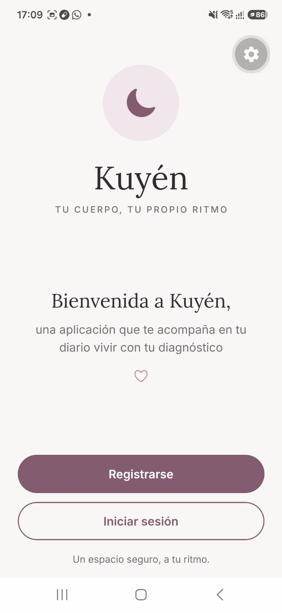
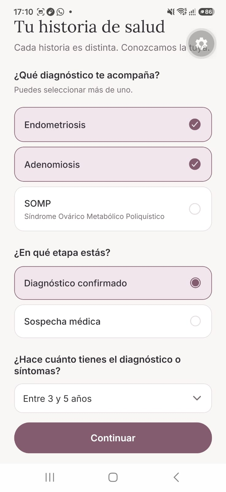
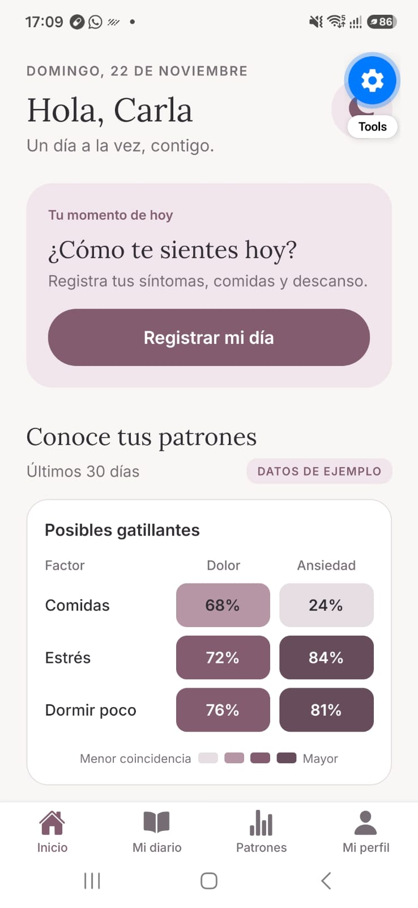

# Kuyén — Tu cuerpo, tu propio ritmo

Aplicación móvil desarrollada en **React Native con Expo** enfocada en el acompañamiento diario de personas menstruantes y con diagnósticos ginecológicos (Endometriosis, Adenomiosis y SOMP), permitiendo registrar síntomas, hábitos y visualizar correlaciones de bienestar de manera cercana y sin sobrecarga cognitiva.

---

## Capturas de la aplicación (Ejecutándose en dispositivo físico)

| Bienvenida (`WelcomeScreen`) | Registro (`RegisterScreen`) | Perfil Clínico (`ClinicalProfileScreen`) |
| :---: | :---: | :---: |
|  |  |  |

| Síntomas (`OnboardingSymptomsScreen`) | Inicio (`HomeScreen`) | Mi Perfil (`ProfileScreen`) |
| :---: | :---: | :---: |
| .jpeg) |  |  |

---

## Stack Tecnológico

* **Framework:** React Native + Expo SDK 58 (TypeScript)
* **Navegación:** React Navigation (`@react-navigation/native`, `@react-navigation/native-stack`, `@react-navigation/bottom-tabs`)
* **Tipografía:** Google Fonts (`@expo-google-fonts/lora` y `@expo-google-fonts/inter`) + `expo-font`
* **Iconografía:** `@expo/vector-icons` (Ionicons)
* **Gestión de estado y datos:** React Context API (`AuthContext.tsx`) + persistencia local simulada (`mockDb.ts` y `sintomas.ts`)

---

## Estructura del Proyecto

```text
kuyen/
├── assets/                     # Íconos de aplicación, splash screen y favicon
├── docs/
│   ├── bitacora.md             # Bitácora de diseño UI/UX, frontend e IA generativa
│   └── img/                    # Capturas del dispositivo, wireframes y evidencia
├── src/
│   ├── components/             # Componentes reutilizables (Button, Chip, TextField, SelectField, etc.)
│   ├── context/                # Estado global de sesión y perfil clínico (AuthContext.tsx)
│   ├── data/                   # Catálogo categorizado de síntomas (sintomas.ts)
│   ├── database/               # Base de datos local simulada en memoria (mockDb.ts)
│   ├── navigation/             # RootNavigator, MainTabs, TabNavigator y tipado de rutas (types.ts)
│   ├── screens/                # Pantallas del flujo principal y onboarding
│   └── theme/                  # Tokens centralizados de colores y tipografía (colors.ts)
├── App.tsx                     # Punto de entrada principal
├── app.json                    # Configuración de Expo
└── package.json                # Dependencias del proyecto
```

---

## Requisitos Previos

* **Node.js:** v18.x o v20.x LTS
* **npm:** v9.x o superior
* **Dispositivo móvil:** App **Expo Go** (compatible con Expo SDK 57 / 58) en Android o iOS, conectado a la misma red Wi-Fi que el equipo de desarrollo.

---

## Instalación y Ejecución Local

1. **Clonar el repositorio:**
   ```bash
   git clone [https://github.com/carlabelen-cl/kuyen.git](https://github.com/carlabelen-cl/kuyen.git)
   cd kuyen
   ```

2. **Instalar las dependencias:**
   ```bash
   npm install
   ```

3. **Iniciar el servidor de desarrollo de Expo:**
   ```bash
   npx expo start
   ```

4. **Abrir en el teléfono:**
   * Escanea el código QR mostrado en la terminal con **Expo Go** (Android) o la cámara del sistema (iOS).
   * *(Opcional)* Si hay restricciones de red local o firewall, ejecuta `npx expo start --tunnel`.

---

## Arquitectura de Navegación

La navegación está estructurada con **React Navigation** y tipada estrictamente mediante `src/navigation/types.ts`:

* **Pila de Autenticación y Onboarding (`RootNavigator.tsx`):**
  * `WelcomeScreen` → `LoginScreen` / `RegisterScreen` → `ClinicalProfileScreen` → `OnboardingSymptomsScreen`.
* **Navegación Principal (`MainTabs.tsx` / `TabNavigator.tsx`):**
  * Barra inferior con 4 pestañas (`Inicio`, `Mi diario`, `Patrones`, `Mi perfil`), respetando zonas seguras (`SafeAreaView`) y alcance ergonómico con una sola mano.