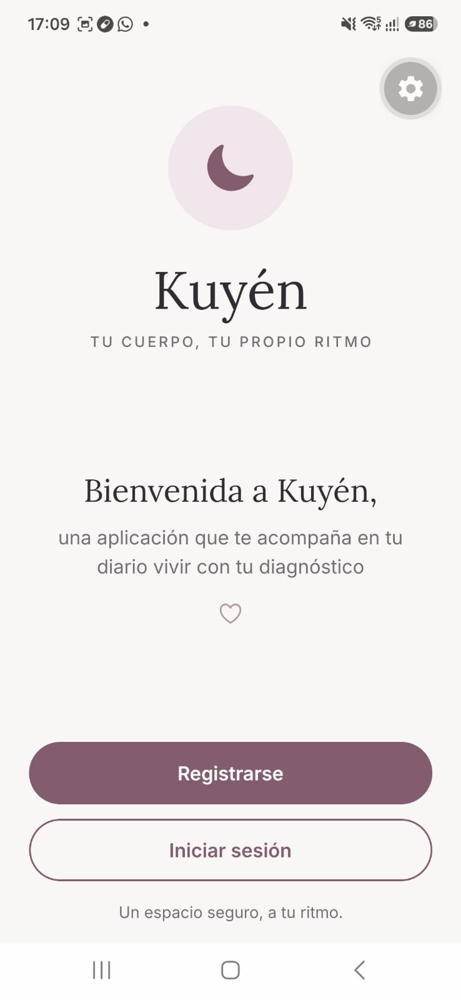
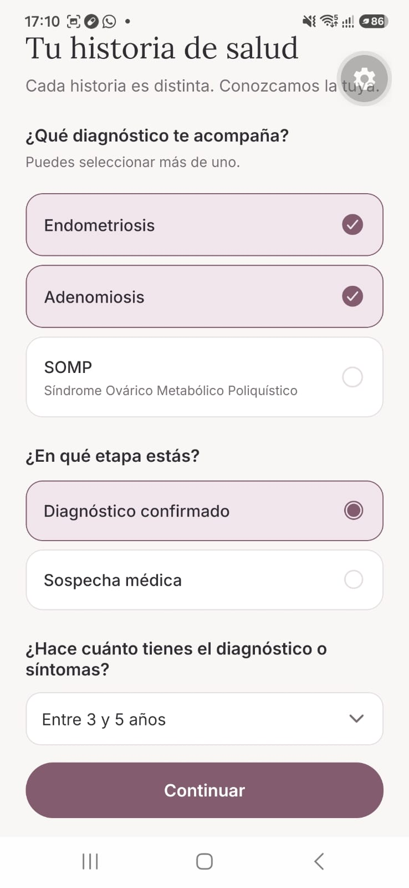
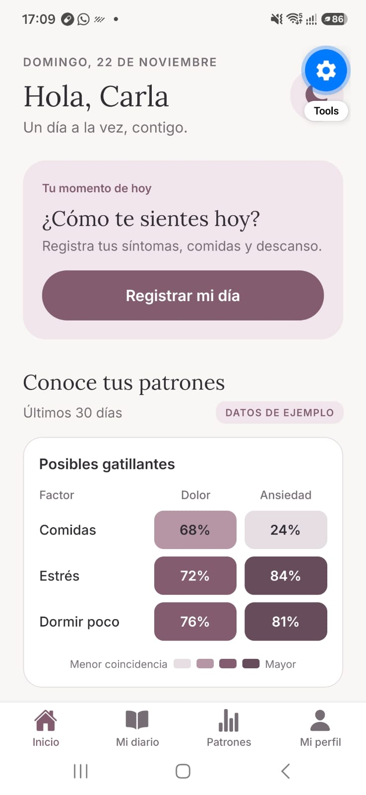

# Bitácora de Diseño UI/UX y Frontend Móvil — Kuyén

**Asignatura:** Tecnologías Web y Móviles (6º semestre) — Ingeniería Civil en Informática, Universidad de los Lagos  
**Estudiante:** Carla Belén Vargas Pacheco  
**Repositorio:** [https://github.com/carlabelen-cl/kuyen](https://github.com/carlabelen-cl/kuyen)  
**Archivo de Diseño (Figma):** [Enlace al proyecto Kuyén en Figma](https://www.figma.com/design/gWEZeufn8JhSFFmMwTTOtn/Kuy%C3%A9n?node-id=0-1&p=f&t=rADpAJ8L0RYsKQmb-0)

---

## 1. Identidad de Marca y UI Kit Base

### Propósito y Nombre
**Kuyén** significa *"Luna"* en mapudungun. El nombre refleja los ciclos naturales del cuerpo y acompaña con cercanía, calma y cero juicio clínico a personas menstruantes y con diagnósticos ginecológicos (Endometriosis, Adenomiosis y SOMP) en su registro diario de síntomas y hábitos.

### Logotipo Vectorial e Ícono de Aplicación
* **Isotipo:** Luna creciente menguante inclinada en tono burdeo (`#815D70`) contenida dentro de un círculo suave (`#F3EBEE` / `#F0E6EB`).
* **Legibilidad y adaptabilidad:** Validado a `48 × 48 px` manteniendo silueta limpia sin detalles finos que se pierdan, exportado como ícono principal (`1024 × 1024 px` en `assets/icon.png`) y pantalla de carga (`assets/splash-icon.png`).

### Paleta de Colores (`src/theme/colors.ts`)

| Rol | Token | Código HEX | Justificación de Diseño y Contraste |
| :--- | :--- | :--- | :--- |
| **Primario** | `primary` | `#815D70` | Burdeo malva cálido; transmite contención, calma y madurez sin caer en estereotipos clínicos fríos. Contraste > 5.8:1 sobre blanco (`#FFFFFF`) y fondo claro (`#FAF7F6`), cumpliendo WCAG AA. |
| **Primario Oscuro** | `primaryDark` | `#684C5B` | Usado en celdas de mayor coincidencia en la matriz de gatillantes y estados activos de alta jerarquía. |
| **Primario Suave** | `primarySoft` | `#B695A5` | Acentos secundarios, indicadores de nivel medio y estados de apoyo visual. |
| **Superficie** | `surface` | `#F0E6EB` | Fondo de tarjetas destacadas, chips inactivos y contenedores suaves que agrupan información sin bordes agresivos. |
| **Fondo Base** | `background` | `#FAF7F6` | Blanco cálido ligeramente rosado que reduce la fatiga visual frente al blanco puro (`#FFFFFF`) en uso diario. |
| **Tarjeta** | `card` | `#FFFFFF` | Contenedores elevados y campos de entrada (`TextField`, acordeones de categorías). |
| **Borde** | `border` | `#E5DDE1` | Delimitación sutil de inputs, botones secundarios y separadores. |
| **Texto Principal** | `text` | `#302D32` | Gris carbón profundo con contraste > 12:1 sobre `#FAF7F6` y `#FFFFFF` (supera ampliamente WCAG AA 4.5:1). |
| **Texto Secundario** | `muted` | `#756D74` | Subtítulos, etiquetas descriptivas y textos de apoyo con contraste > 4.6:1 sobre fondo claro. |

### Escala Tipográfica (`src/theme/colors.ts`)
* **Títulos (`heading` — `Lora_400Regular`):** Tipografía que aporta calidez editorial y cercanía emocional en encabezados de pantalla (`26–32 pt`).
* **Cuerpo y Controles (`body` / `medium` / `semi` — `Inter_400Regular`, `Inter_500Medium`, `Inter_600SemiBold`):** Tipografía sans-serif de alta legibilidad en pantallas móviles (`16 pt` en cuerpo y campos de texto, `13–14 pt` en etiquetas y chips).

---

## 2. Arquitectura y Flujo de Usuario

### Storyboard (Caso de Uso Principal en Contexto Móvil)
1. **Viñeta 1 — Bienvenida y creación de cuenta (`WelcomeScreen` → `RegisterScreen`):** La usuaria inicia Kuyén desde su teléfono con una mano y completa sus datos básicos (nombre, edad, nacionalidad, correo y contraseña) con desplazamiento automático ante el teclado (`KeyboardAwareScroll`).
2. **Viñeta 2 — Configuración de perfil clínico (`ClinicalProfileScreen`):** Selecciona uno o más diagnósticos (Endometriosis, Adenomiosis, SOMP), su etapa (diagnóstico confirmado o sospecha médica) y antigüedad mediante tarjetas y selectores táctiles amplios.
3. **Viñeta 3 — Selección de síntomas habituales (`OnboardingSymptomsScreen`):** Filtra mediante buscador en tiempo real o despliega categorías colapsables (*Digestivo y urinario*, *Dolor*, *Ciclo y sangrado*, *Energía y sueño*, *Ánimo y mente*, *Piel y cabello*, *Metabolismo y peso*, *Cabeza y cuerpo*, *Salud íntima*) sin saturar la pantalla.
4. **Viñeta 4 — Visualización de inicio y patrones (`HomeScreen`):** Accede al panel principal donde visualiza su saludo personalizado (`Hola, Carla`), acceso directo al registro diario y la matriz de posibles gatillantes (Comidas, Estrés, Dormir poco vs. Dolor y Ansiedad).
5. **Viñeta 5 — Gestión de perfil y sesión (`ProfileScreen`):** Consulta sus datos personales registrados en memoria (`AuthContext` / `mockDb`) y cierra sesión de forma segura.

### Mapa de Navegación (`src/navigation/`)
El flujo se organiza en **React Navigation** con tipado estricto (`src/navigation/types.ts`):
* **`RootNavigator.tsx` (Stack principal):**
  * Flujo no autenticado / onboarding: `WelcomeScreen` → `RegisterScreen` (o `LoginScreen`) → `ClinicalProfileScreen` → `OnboardingSymptomsScreen`.
  * Una vez completado el perfil, redirige automáticamente a `MainTabs`.
* **`MainTabs.tsx` / `TabNavigator.tsx` (Barra inferior de 4 pestañas):**
  * `Inicio` (`HomeScreen.tsx`)
  * `Mi diario` (`PlaceholderScreen.tsx`)
  * `Patrones` (`PlaceholderScreen.tsx`)
  * `Mi perfil` (`ProfileScreen.tsx`)

*(Nota: El diagrama completo del Storyboard, Wireframes y Mapa de Navegación se encuentra en la página `02 · Wireframes y Flujo` del archivo de Figma).*

---

## 3. Evolución Visual: Wireframes vs. Alta Fidelidad

En la etapa de ideación se construyeron wireframes de baja fidelidad en escala de grises (`390 × 844 pt`) priorizando la estructura, jerarquía y alcance del pulgar antes de aplicar el sistema visual en los mockups de alta fidelidad:

| Pantalla | Wireframe (Baja Fidelidad) | Implementación / Alta Fidelidad |
| :--- | :--- | :--- |
| **Bienvenida** | Estructura centrada con isotipo superior y dos acciones apiladas en el tercio inferior. |  |
| **Registro (`paso 1`)** | Formulario vertical de campos apilados con botón primario fijo al final del scroll. |  |
| **Historia de Salud (`paso 2`)** | Tarjetas de selección múltiple y selector desplegable antes del botón continuar. |  |
| **Síntomas (`paso 3`)** | Buscador superior + contenedores colapsables por categoría para evitar scroll infinito. | .jpeg) |
| **Inicio (`HomeScreen`)** | Saludo superior, tarjeta CTA en zona media-inferior y grilla de correlaciones. |  |

---

## 4. Evidencia del Frontend Móvil (Dispositivo Real)

Capturas tomadas directamente desde el teléfono ejecutando la aplicación mediante **Expo Go**:

### Flujo de Registro y Onboarding Clínico
| Paso 1: Cuenta (`RegisterScreen`) | Paso 2: Diagnóstico (`ClinicalProfileScreen`) | Paso 3: Categorías (`OnboardingSymptomsScreen`) | Paso 3: Selección activa de chips |
| :---: | :---: | :---: | :---: |
|  |  | .jpeg) | .jpeg) |

### Detalle de Categorías Expandidas, Inicio y Perfil
| Categoría Metabolismo (`OnboardingSymptomsScreen`) | Pantalla Inicio (`HomeScreen`) | Pantalla Perfil (`ProfileScreen`) |
| :---: | :---: | :---: |
| .jpeg) |  |  |

---

## 5. Justificación Técnica y Ergonómica

1. **Reducción de carga cognitiva en `OnboardingSymptomsScreen`:** En lugar de desplegar más de 70 síntomas simultáneamente en pantalla, se diseñó un sistema de **acordeones por categoría** con contador de opciones (`14 opciones`, `11 opciones`, etc.), badge numérico de seleccionados y un buscador superior (`TextField`). Así, la usuaria navega con calma y encuentra sus síntomas sin abrumarse.
2. **Ergonomía móvil y alcance del pulgar:**
   * Todos los botones principales (`Registrar mi día`, `Continuar`, `Registrarse`, `Cerrar sesión`), tarjetas seleccionables y chips cumplen con un área táctil mínima superior a **48 dp / 44 pt**.
   * La barra de navegación inferior (`TabNavigator.tsx`) ubica las 4 secciones principales en el borde inferior al alcance directo del pulgar.
3. **Respeto de zonas seguras y teclado:** Se emplea `SafeAreaView` (`react-native-safe-area-context`) para evitar superposición con la barra de estado y botones del sistema, junto con `KeyboardAwareScroll.tsx` para que el teclado nunca oculte los campos de correo o contraseña al escribir.
4. **Centralización y reutilización:** Los colores y fuentes están desacoplados en `src/theme/colors.ts`, y los controles (`Button`, `Chip`, `TextField`, `SelectField`) reciben `props` tipadas para garantizar consistencia 1:1 con Figma.

---

## 6. Bitácora de Uso Responsable de IA Generativa

Para el desarrollo de este avance se utilizaron dos herramientas de IA generativa con roles claramente separados y validación crítica en cada entrega:

| Etapa | Herramienta | Rol Principal |
| :--- | :--- | :--- |
| **Arquitectura y Código Frontend** | **Claude** | Generación de estructura de carpetas en TypeScript, pantallas de React Native, componentes reutilizables (`Button`, `Chip`, `KeyboardAwareScroll`) y contexto de sesión (`AuthContext` + `mockDb`). |
| **Diseño UI/UX, Wireframes y Figma** | **Gemini** | Generación de wireframes en escala de grises en formato vectorial SVG, storyboard en contexto móvil, isotipo vectorial limpio y revisión de cumplimiento contra la rúbrica. |

### Registro de Prompts Principales y Validación Crítica

1. **Estructuración del proyecto y pantallas desde Figma (Claude):**
   * *Prompt real:* `"debo de crear hasta inicio, te paso también el archivo donde dice que tecnologías ocuparé, trabajo en VS me puedes dar el paso a paso para crear esta app móvil?"` / `"ya, ahora debes basarte en el figma que te envie para poder crear las pantallas, debes decirme que hace cada parte del código que estamos generando :D"`
   * *Validación y corrección:* Al ejecutar en Expo Go, se detectó que el teclado cubría los campos de correo y contraseña en `RegisterScreen` y que `HomeScreen` mostraba el nombre fijo `"Hola, Antonia"` en lugar del usuario registrado. Se solicitó corregir ambos puntos (`"el teclado tapa cuando quiero agregar correo y contraseña, la idea es que se mueva, y que se vea... cuando ingreso, dice Hola, Antonia, y yo ingresé el nombre carla, este registro debería poder registrarse en un archivo mock"`), implementando `KeyboardAwareScroll.tsx` y conectando `mockDb.ts` con `AuthContext.tsx`. Además, faltaba crear `ProfileScreen.tsx` que ya estaba importada en `MainTabs.tsx`, lo cual se resolvió creando la pantalla funcional.

2. **Rediseño ergonómico de la pantalla de síntomas (Claude):**
   * *Prompt real:* `"en la sección escuchemos tu cuerpo, acontece que, en dolor, digestivo y ánimo sistémico son muy pocas las opciones que aparecen... me gustaría que pudieran escoger entre muchísimoooos mas síntomas, pero tampoco quiero que la pantalla se vea con mil sintomas y a que la usuaría le sea imposible navegar, la idea es que sea lo mas relajante posible"`
   * *Validación y corrección:* Se amplió `src/data/sintomas.ts` a 9 categorías clínicas reales (Digestivo y urinario, Dolor, Ciclo y sangrado, Energía y sueño, Ánimo y mente, Piel y cabello, Metabolismo y peso, Cabeza y cuerpo, Salud íntima) implementando acordeones colapsables y búsqueda instantánea.

3. **Generación de isotipo vectorial y wireframes para Figma (Gemini):**
   * *Prompt real:* `"el logo tiene que estar en un tipo de formato, SVG me parece (para que me lo pases tal cual como está ahí (el circulo con la lunita en medio) y además necesito el wireframe (el que es en escala de grises, sin detalles muy grandes, es como si fuera el boceto a lapiz) para que también me lo pases y lo pueda pegar en el figma :D"`
   * *Errores detectados y corregidos:*
     * **Error de sintaxis XML en SVG:** El primer SVG de wireframes falló al importarse en Figma (`Unable to convert SVG`) porque contenía un símbolo `<` sin escapar dentro de una etiqueta `<text>` (`(< 14 días)`). Se corrigió reemplazándolo por texto plano (`menos de 14 días`) y validando el XML.
     * **Alucinación de rutas de navegación:** Inicialmente la IA asumió que el proyecto usaba `Expo Router` (`src/app/_layout.tsx`) basándose en la rúbrica general, en lugar de `React Navigation` (`src/navigation/RootNavigator.tsx` + `MainTabs.tsx`). Se le entregó el árbol real de carpetas del repositorio para regenerar el Mapa de Navegación y los Wireframes 100% fieles al código real.
